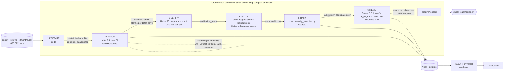

# Where should Spotify's next quarter of product effort go?

A code-orchestrated, multi-role LLM pipeline that turns 660,622 Spotify Google Play reviews (May 2022 – Nov 2023) into a traceable product recommendation. Agentic AI final assignment, Brian Arevalo Ramos.

**Live dashboard:** https://spotify-review-dashboard-vert.vercel.app (public, no login; reads everything from a Neon Postgres database through a FastAPI backend; makes no model calls)

**Recommendation** ([memo.md](memo.md)): put next quarter's effort into **billing/support**, starting with **free-tier restrictions** (`billing.premium_only_restrictions`). It is the #1 *specific* issue: 9,469 complaints, severity sum 26,088, mean severity 2.755. The only issue ranked above it is the non-actionable "general criticism" bucket. Ads (`usability.ads_frequency`) is the closest companion. Login failure (`access.login_failure`) is the most severe issue (mean 3.91) but has a much smaller reach.

## Results at a glance

| | Value | Evidence |
|---|---|---|
| Rows ingested and profiled | **660,622** (13 empty texts, 159,701 missing app versions, 0 duplicate IDs, 484,189 distinct texts), all matching the brief and the course helper | [outputs/ingestion_report.json](outputs/ingestion_report.json), [grading/ingestion.json](grading/ingestion.json) |
| Declared classification scope | **150,013 rows** = 150,000 nonempty reviews + the 13 empty texts | [outputs/scope.json](outputs/scope.json) |
| Classified (valid, completed) | **149,972 / 150,000 = 99.98%** | [grading/records.jsonl.gz](grading/records.jsonl.gz) |
| Quarantined | **41** = 13 `empty_review_text` + 28 `quote_not_in_source (after recovery pass)` | same, plus `status` and `reason` fields |
| Exact-text cache reuse | **34,459** records reused a direct, validated result for identical text (`cache_source_id`) | records; checker `valid_cache_reuses` |
| Independent verifier (2,310 random reviews, blind) | topic **87.0%**, intent **93.3%**, severity **86.2%** agreement; severity MAE 0.14 | [outputs/verification_report.json](outputs/verification_report.json) |
| Planted wrong labels caught | **20 / 20** | same file, `planted_error_test` |
| Golden 50 (hand-labeled, blind) | topic **54%**, intent **90%**, severity **72%** exact (MAE 0.50) | [evals/golden_eval.md](evals/golden_eval.md) |
| Golden 50 after post-hoc adjudication (disclosed) | 92% acceptable on all three fields (16 human errors, 8 ambiguous, 4 model errors) | [evals/golden_eval.json](evals/golden_eval.json) |
| Prompt-injection and edge-case tests | **8 / 8 pass** (real model); malformed output and HTTP 429 recovery pass (simulated) | [evals/system_tests/](evals/system_tests/) |
| Full-run API spend (measured) | **$6.30** (2,426 calls, 2 failed attempts retried); Haiku 5.5 enrichment ≈ $6.0 | [grading/calls.jsonl](grading/calls.jsonl) |
| Full-run wall clock (measured) | enrichment ≈ 96 min at 4→6 workers; verify + group + rank + memo ≈ 5 min | [outputs/run_log.jsonl](outputs/run_log.jsonl) |
| 100-review pilot (measured) | cold **61.1 s / $0.0332**; warm (saved results) **0.02 s / $0, 0 calls** | [cost/report.md](cost/report.md) |
| Course self-check | 100% of rows accounted for; coverage candidate **0.9999**; 2 explained flags (below) | [evals/checker/self-check.json](evals/checker/self-check.json) |

Measured values come from logs. The only estimates are the calculator's projections, which are labeled as scenarios in [cost/report.md](cost/report.md).

**Scope.** The instructor set the minimum at 100,000 classified reviews and confirmed it counts as full credit. We classified 150,000 by **extending the course's own sampling order**: lowest SHA-256(`seed:review_id`) among unique, nonempty, valid-rating rows. Our first 50 ranks are exactly `golden_50_to_label.csv`, and ranks 50–10,049 are exactly `analysis_10000.csv`, so the 100, 500 and 10k development files sit inside our scope (verified in [outputs/ingestion_report.json](outputs/ingestion_report.json)). The sample is a uniform, deterministic random sample across all 18 months. The other 510,609 rows are ingested, profiled and hashed but not classified.

## Architecture



| Stage | Who decides | Input → output | Failure behavior and stop condition |
|---|---|---|---|
| 1 Prepare | code | CSV → `records` table (one row per scoped ID: hash, text, status), ingestion report, scope file | Strict CSV parser (multiline text); empty text → `quarantined/empty_review_text`; never deletes source rows |
| 2 Enrich | **model** (Haiku 5.5, thinking off, structured JSON) | ≤50 pending reviews per request, keyed `1..n` → topic, subtopic, intent, severity, sentiment, entities, evidence quote, needs_review | Code validates every key, enum, range and **exact quote substring**. Invalid → retry once, then quarantine with reason. Transient API errors → bounded backoff. Spend ledger reserves worst-case cost **before** each call and refuses work past the cap. Exact-text cache under an unchanged `label_config`. |
| 3 Verify | **model** (separate prompt and role) | declared random sample (2%, hash-chosen) → independent topic/intent/severity, without seeing stage 2's answer | Code compares and writes a disagreement report; planted-error copy shows the comparison catches wrong labels |
| 4 Group | **code** (membership) + **model** (names only) | complaint/cancellation records → one issue each (`topic.subtopic`); bounded examples → issue names | Model can't change membership; invented issue IDs are rejected |
| 5 Rank | code | membership + records → `priority = severity_sum`, sorted desc, then issue ID | `python -m pipeline rerank` rebuilds identical output with no model |
| 6 Memo | **model** (Sonnet 5.5, low effort) | ranking top 12, topic aggregates, 18 representative reviews | Code recomputes every claim value, flags any number not traceable to the pack, and rejects review IDs not in the evidence. A person reviews the argument. |

**Why a model at all, and why only there:** the model is used only where language judgment is needed (stages 2, 3, the issue naming in 4, and 6). Counting, deduplication, validation, grouping membership, ranking arithmetic and record accounting are deterministic code. Every model role has its own prompt ([prompts/](prompts/)), its own inputs and outputs, and its own entries in the call log.

## How to run

```bash
git clone https://github.com/BuildingBrian/spotify-review-pipeline && cd spotify-review-pipeline
python3 -m venv .venv && .venv/bin/pip install -r requirements.txt
# Dataset: download the course ZIP (https://drive.google.com/file/d/1P0rUoAS_wVjp3BYKqXMEyD4u0uJP1Bvf/view),
# unzip into data/dataset/ (spotify_reviews_18months.csv sha256 1fc85de68a304dd8978b537cfa58793d5f41cbaf417fa32cb53899f83a2fcef6)
cp .env.example .env   # only needed for PAID commands; add ANTHROPIC_API_KEY (and DATABASE_URL to load the dashboard DB)
```

| What | Command | Model calls? |
|---|---|---|
| Ingest and profile all rows, choose scope (accepts any CSV: `--input X.csv --all`) | `.venv/bin/python -m pipeline prepare` | no |
| **Full pipeline** (resumable; rerun the same command to continue) | `.venv/bin/python -m pipeline run --paid --workers 6 --cap 15` | **yes** |
| Regenerate the ranking from saved outputs | `.venv/bin/python -m pipeline rerank` | no |
| Cost calculator offline replay (default) | `.venv/bin/python cost/calculator.py` (try `--rates-mult 2`) | no |
| Paid 100-review pilot (explicit) | `.venv/bin/python -m pipeline --workdir cost/pilot run --paid --input data/dataset/cost_100.csv --all --workers 1 --verify-frac 0.2` | **yes** |
| Grading export + course checker | `.venv/bin/python -m pipeline export-grading --before enrich-20261019-110200-end.json --after enrich-20261019-110459-end.json` | no |
| Golden evaluation | `.venv/bin/python evals/golden_eval.py` | no |
| System tests | `.venv/bin/python evals/system_tests.py offline` · `... injection --paid` | offline / yes |
| Load the dashboard DB | `.venv/bin/python -m pipeline load-db` | no |
| Live progress tracker during runs | `.venv/bin/python -m pipeline tracker` (http://127.0.0.1:8766) | no |

The grader's `--analysis` file for `check_submission.py reference` is our declared scope: [outputs/analysis_scope.csv.gz](outputs/analysis_scope.csv.gz) (gunzip it; sha256 is in [grading/run.json](grading/run.json)). `prepare` regenerates it deterministically.

## Rubric → evidence

**Deliverable quality (4)**
1. *Accessible code, setup and artifacts:* this README; [pipeline/](pipeline/) (one file per stage); pinned [requirements.txt](requirements.txt); blank [.env.example](.env.example); `.gitignore` excludes `.env`, raw data and SQLite state; the dataset link and checksum are above.
2. *Architecture, shared schema, provenance:* the diagram and table above; [labels/definitions.md](labels/definitions.md) (the shared topics, intents and severity, our worked examples and subtopics, used verbatim by the human labeler and by both model roles); enrichment JSON schema in [pipeline/enrich.py](pipeline/enrich.py). Every record carries `source_sha256` (course hash convention), `label_config` (`claude-haiku-5-5+thinking-disabled+enrich-v1-a43a4634+schema-v1`, where the hash fingerprints the prompt, definitions and schema) and `cache_source_id` where applicable. Manifest: [outputs/data_manifest.json](outputs/data_manifest.json).
3. *Memo numbers linked to calculations and sources:* [memo.md](memo.md) cites claim IDs [C1]–[C9] → [grading/claims.csv](grading/claims.csv) → recomputed from [grading/ranking.csv](grading/ranking.csv) and [grading/membership.csv](grading/membership.csv). The code check is in [outputs/memo_check.json](outputs/memo_check.json): 9/9 claims match, 0 untraceable numbers, 0 unknown IDs. The memo saw only [outputs/memo_input_pack.json](outputs/memo_input_pack.json).
4. *Recommendation, alternatives, limitations:* [memo.md](memo.md) and the "Interpretation" section below.

**Testing and evaluation (3)**
1. *50 human labels, per-field comparison, error analysis:* [evals/golden_human_labels.csv](evals/golden_human_labels.csv), [evals/golden_eval.md](evals/golden_eval.md) and [evals/golden_eval.json](evals/golden_eval.json); "Golden set" section below.
2. *Independent verification, planted errors, injection:* [outputs/verification_report.json](outputs/verification_report.json), [evals/system_tests/injection_results.json](evals/system_tests/injection_results.json), [evals/system_tests/offline_results.json](evals/system_tests/offline_results.json).
3. *Cold/warm pilot, calculator, controls:* [cost/report.md](cost/report.md), [cost/calculator.py](cost/calculator.py), [cost/pilot_calls.jsonl](cost/pilot_calls.jsonl), [cost/pilot_records.jsonl](cost/pilot_records.jsonl), [cost/rates.csv](cost/rates.csv) (dated sources), [cost/usage.csv](cost/usage.csv), [cost/assumptions.json](cost/assumptions.json). Controls are demonstrated by the spend ledger and cap, retry-once-then-quarantine, 429 backoff, and the real interruption and resume.

**Working result (3)**
1. *Ingestion, coverage, classification:* [grading/](grading/) passes the checker's coverage checks (100% accounted, 99.98% classified); [evals/checker/self-check.json](evals/checker/self-check.json).
2. *Staged program, bounded calls, saved handoffs, resume:* `python -m pipeline run`; ≤50 reviews per enrichment call (checker `unbounded_batch` = 0); per-stage files in [outputs/](outputs/); real interruption and resume → [grading/checkpoint_before.json](grading/checkpoint_before.json) (23,096 IDs) → [grading/checkpoint_after.json](grading/checkpoint_after.json), with 0 completed IDs re-sent; transcript in [evals/resume_evidence/terminal_transcript.txt](evals/resume_evidence/terminal_transcript.txt).
3. *Reproducible ranking and deployed dashboard:* `python -m pipeline rerank`; https://spotify-review-dashboard-vert.vercel.app (FastAPI in [dashboard/api/](dashboard/api/) → Neon Postgres, loaded by [pipeline/load_db.py](pipeline/load_db.py)).

## One review, traced end to end

`e0a90a21-ae9c-4274-8946-f89b223f7b68` (★1, 2023-10-17): *"why remove the most BASIC needs for free users."*

1. **Source:** row hash `bfe29e36…`, scope rank in the course order (core sample).
2. **Enrichment** (Haiku, batch of 50): `billing / premium_only_restrictions / complaint / severity 3 / sentiment −0.7`, quote = the full text (exact substring ✓), entities `["free users"]`.
3. **Verification** (blind 2% sample): verifier said `billing / complaint / 3`, agreeing on all three fields.
4. **Issue membership:** `billing.premium_only_restrictions` ([grading/membership.csv](grading/membership.csv)).
5. **Ranking:** that issue is rank 2: 9,469 complaints, severity sum 26,088, mean 2.755096.
6. **Memo claims:** [C1] complaint_count = 9469, [C2] severity_sum = 26088, [C3] mean_severity = 2.755096, all recomputed by code.

On the dashboard, open the issue from the ranking table, or open any review ID for its full trace.

**A failed case and how it was handled:** `86fbcb0d…` *"Love the app music is great on here only down side is of you want to play any song you want you'll need premium"*. The model's evidence quote silently "fixed" the customer's typo ("of" → "if"), so it was not an exact substring. Code rejected it, retried once, and quarantined it (`quote_not_in_source`). A declared recovery pass then re-labeled all 76 such reviews. There, code maps the model's quote back to the **exact original characters** when they are ≥85% similar (the quote is never the model's wording). 48 recovered; this one was still too far off and stays quarantined (`quote_not_in_source (after recovery pass)`, 3 attempts). Recovered records carry `label_config …+recovery-fuzzyquote`.

## Golden set (50 hand-labeled reviews)

Brian labeled all 50 in a local tool ([pipeline/golden_tool.py](pipeline/golden_tool.py)) using the same definitions. The labels were never model inputs, examples, thresholds or grouping inputs. The prompt was frozen before labeling, so golden results did not influence any prompt revision.

| Field | Blind agreement | Notes |
|---|---|---|
| intent | **90%** | |
| severity (exact) | **72%** | MAE 0.50 |
| topic | **54%** | most disagreements are `other` vs a specific topic |
| sentiment within ±0.3 (declared tolerance) | 76% | |
| quote is an exact substring | 100% | |

**Error analysis.** Brian adjudicated each of the 28 disagreements **after** seeing the model's answer. This is post-hoc, so it is disclosed and kept separate from the blind numbers.
- 16 cases: the human label conflicted with the shared definitions. Examples: generic praise labeled with a specific topic and severity 3; angry political text labeled severity 5, when the definition reserves 5 for explicit financial, privacy or data harm.
- 8 cases: genuinely ambiguous. Examples: "can't choose songs without premium" could be usability or billing; short non-English reviews.
- 4 cases: model errors. The clearest is *"paying for subscribing but unable to play in offline mode"*, where the model said playback / severity 4 and downloads / offline is the better fit.

50 cases is a small diagnostic sample, not a population accuracy estimate. Combined with the 2,310-review blind verifier (87–93% agreement), the main measured risk is the boundary between `other` and specific topics. That boundary mostly affects the size of the `other.general_criticism` bucket, not the ranking of specific issues.

## Cost and runtime

Full details are in [cost/report.md](cost/report.md); it is regenerated offline from saved usage × editable dated rates.

- Haiku 5.5: $0.10 / $0.50 per million input / output tokens; cache reads $0.01. Sonnet 5.5 (memo only): $2 / $10. Rates checked 2026-10-18.
- Pilot (cost_100.csv, 1 worker, empty cache): 6 calls, **$0.0332, 61.1 s**. Warm rerun: **0 calls, $0, 0.02 s**. Downstream stages are skipped by input fingerprint.
- The pre-run projection for 150k was $6.86 base / $7.35 conservative. The actual cost was **$6.30**, because exact-text reuse (34,459 records) and the prompt cache (9.3M cached input tokens) did better than assumed.
- Controls: a $15 hard cap (ledger reservation before dispatch), ≤50 reviews and ≤7,800 output tokens per request, ≤6 workers, retry invalid output once, ≤4 transient attempts with exponential backoff and jitter, no stronger-model fallback for enrichment (fallback fraction 0).

## Interpretation (summary of the memo)

- **Billing/support** is the recommended area. Within it, the work is free-tier restrictions (skip limits, forced shuffle, can't pick songs or rewind), not payment errors or support response; support volume is tiny (143 complaints). Billing has the most cancellation-intent reviews of any topic (2,419). That is expressed intent, not churn.
- **Alternatives:**
  - *Usability* has the largest complaint volume (15,502), but mostly low severity. Its biggest driver is ads (8,073), which overlaps with the free-tier experience.
  - *Access* has the highest severity (login failure, mean 3.91) but small reach (1,877). It's worth a targeted fix.
  - *Playback* issues are severe but each is smaller.
- **Limitations:**
  - These are self-selected public reviews from a historical window.
  - There is no revenue, plan-tier or churn data, so business impact is unknown.
  - Labels are model-assigned, with the agreement levels above.
  - The baseline ranking rewards volume, so the generic `other.general_criticism` issue ranks #1. The memo sets it aside because it is not actionable.
  - The first and last months are partial.

## Known issues the checker flags (explained, not hidden)

- `unfinished_classification` (28): the reviews still quarantined after the recovery pass. They are counted as not classified.
- `call_config_mismatch` (96): the 48 recovered reviews also appear in the earlier enrichment calls whose answers code **rejected**. Those calls succeeded at the HTTP level with the base `label_config`, while the final records carry the recovery tag. The call log is kept as the true record rather than rewritten.

## Repository map

`pipeline/` stages and CLI · `prompts/` role prompts (enrich, verify, group, memo) · `labels/` shared definitions · `outputs/` saved handoffs (manifest, ingestion, scope, verification, issues, membership, aggregates, ranking, memo pack, memo check, run log) · `grading/` standardized export · `evals/` golden set, checker report, system tests, resume evidence · `cost/` calculator and pilot evidence · `dashboard/` backend and frontend · `memo.md` the decision memo.

Built with Claude Code (Claude Opus 5.5) as a coding assistant. Brian chose the scope and tools, hand-labeled the golden set and adjudicated the disagreements.
